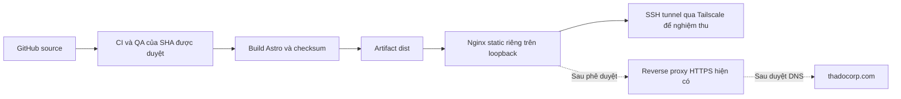

# Khảo sát và chuẩn bị self-host ngày 23/11/2026

## Kết quả khảo sát chỉ đọc

Đã SSH BatchMode qua Tailscale bằng tài khoản được cấp. Host báo Arch Linux rolling, kernel 7.2.11-arch1-1, Docker 29.9.1, Compose 5.6.0. Không sửa file, restart dịch vụ hoặc tạo container trên server.

| Phát hiện | Bằng chứng và giới hạn |
| --- | --- |
| Forgejo 17.0.1 và hai runner | docker ps. Web bind 127.0.0.1:3000, SSH container bind 0.0.0.0:2222 |
| Ganbarou | frontend bind 127.0.0.1:80, backend và Postgres ở mạng Docker |
| Sodichoi | web, API, Postgres và container Caddy đang chạy |
| Reverse proxy | Caddy v2.11.9 trong container, bind 127.0.0.1:8080. Caddy/nginx host service inactive |
| Cloudflare | cloudflared host service active. Chưa đọc credential hoặc xác minh route tunnel |
| Tailscale | Serve HTTPS proxy đến loopback 3000, trạng thái tailnet only. Funnel chưa công khai hostname này |
| Cổng khác | SSH 22, Forgejo SSH 2222 bind mọi interface. Chưa xác minh firewall/NAT nên chưa kết luận truy cập Internet |
| Dung lượng | / còn 4,9 GB trên 23 GB, /home còn 195 GB trên 211 GB |
| Backup | Không thấy timer khớp backup/restic/borg/snapshot. Chưa kiểm tra cron, remote backup hoặc restore drill |
| Registry | Container app đang dùng registry trên hostname tailnet. Forgejo/registry là hạ tầng tùy chọn cho dự án |
| HTTP loopback | 80, 3000, 8080 đều trả 200. Chưa nghiệm thu THADO trên các địa chỉ này |

Không sử dụng token Forgejo. Thu hồi token cũ là **OWNER TO VERIFY** trong Settings của Forgejo, đối chiếu tên token, thời điểm và trạng thái thu hồi. Không gửi giá trị token cho agent.

Cần anh Hưng xác minh routing tunnel, public IP/NAT, DNS authority, backup, restore và người vận hành. Chưa khảo sát nội dung cấu hình có thể chứa bí mật.

## Phương án đề nghị duyệt



Giữ GitHub làm source hiện tại. Build trên máy tin cậy hoặc CI Linux với Node 24.21.0 và npm lockfile. Server chỉ nhận artifact tĩnh, không cần Node chạy thường trực, source checkout, database hoặc token GitHub/Forgejo.

Dùng thư mục riêng dự kiến /home/traidep/thado-web, tách khỏi /home/traidep/forgejo. Container Nginx riêng phục vụ releases qua symlink current, mount parent directory read-only để atomic switch có hiệu lực. Không join network Forgejo. Thư mục deploy dành riêng cho THADO, quyền ghi chỉ cấp người vận hành. Thành viên nhóm Docker có quyền quản trị mạnh trên host, không cấp quyền đó cho tài khoản chỉ tải artifact. Chủ server khởi tạo/restart container, người deploy chỉ cập nhật releases/current trong thư mục được cấp.

Cổng staging đề xuất 127.0.0.1:8090 chưa thấy sử dụng khi khảo sát. Kiểm tra lại ngay trước triển khai. Nghiệm thu qua SSH local forwarding trên Tailscale, không cần mở firewall hoặc DNS. Đây là đề xuất, chưa được phép triển khai.

## Cấu hình chuẩn bị

- deploy/nginx.conf chuyển CSP và các header từ Cloudflare sang Nginx, dùng always cho cả 404. _headers bị chặn và không được dùng làm cấu hình runtime.
- HTML, site.js và ảnh tên cố định dùng no-cache. Asset có hash trong /_astro/ dùng cache immutable một năm. Lỗi dùng no-store. 404 trả trạng thái 404 và nội dung nhận diện.
- deploy/compose.staging.yml dùng non-root UID 101, read-only filesystem/mount, tmpfs, bỏ capabilities, no-new-privileges, log rotation và giới hạn bộ nhớ.
- Chọn image nginx chính thức, ghim digest đã duyệt vào THADO_NGINX_IMAGE. Xác nhận UID của image. THADO_SITE_ROOT là đường dẫn tuyệt đối đến parent chứa current và releases.
- Template không bật TLS hoặc HSTS. Loopback staging chỉ có HTTP. HTTPS/redirect và HSTS là trách nhiệm edge đã kiểm chứng khi chuyển sang production.
- Compose config đã qua kiểm tra cú pháp cục bộ. Docker daemon của máy local chưa chạy, nên nginx -t và container runtime là **PENDING**. Server được cấp quyền khảo sát chỉ đọc, chưa chạy container thử ở đó.

Nginx kế thừa header nếu location không khai báo add_header riêng. Cấu hình cache được đặt chung tại server để giữ các header bảo mật. [Nginx headers](https://nginx.org/en/docs/http/ngx_http_headers_module.html)

## Quy trình build và kiểm soát SHA

Chỉ sau khi chủ dự án ghi phê duyệt SHA đầy đủ trong PR. Dùng checkout sạch riêng, không dùng working tree đang có thay đổi.

```sh
git fetch origin
APPROVED_SHA='<SHA 40 ký tự đã duyệt>'
git switch --detach "$APPROVED_SHA"
test "$(git rev-parse HEAD)" = "$APPROVED_SHA"
test -z "$(git status --porcelain)"
npm ci
export GANBAROU_URL=https://heyganba.site/
export JIAYOU_URL=
# Staging dùng preview noindex
unset SITE_ENV SITE_URL
npm run check
npm run build
npm run test:e2e
npm audit
```

Dừng ngay nếu lệnh nào thất bại, nên chạy toàn bộ trong shell có set -eu. Cài browser bằng npx playwright install --with-deps chromium webkit trên build runner Linux trước bộ test.

Đối chiếu link Ganbarou ở dist/index.html và dist/en/index.html. Jiayou phải Coming soon. Kiểm tra không có .env, .git, source map, credential hoặc symlink trong dist. Không giả định .env.example tự được dùng. Ghi SHA, chế độ build, Node/npm, biến URL công khai, kết quả QA vào manifest bên ngoài dist.

```sh
tar -czf "thado-$APPROVED_SHA.tar.gz" -C dist .
sha256sum "thado-$APPROVED_SHA.tar.gz" > "thado-$APPROVED_SHA.tar.gz.sha256"
```

Người duyệt lưu checksum ở kênh tin cậy của PR. Checksum xác minh toàn vẹn, cần đối chiếu với giá trị do người build tin cậy cung cấp để xác minh nguồn. Khi nhận artifact qua scp, chạy sha256sum -c và so với manifest/SHA trước khi giải nén. Chỉ nhận tar do quy trình build tin cậy tạo, kiểm tra danh sách tar không có path tuyệt đối, .., symlink hoặc nội dung ngoài dist. Tạo release directory mới và để artifact/manifest ở ngoài web root. Chỉ phục vụ dist.

## Staging sau khi được duyệt

1. Anh Hưng duyệt container, image digest, thư mục, port và người vận hành. Chạy lại ss -lnt, kiểm tra dung lượng. Tạo thư mục releases và log/backup riêng, không thay đổi Compose của Forgejo.
2. Chuyển artifact đã kiểm checksum đến releases/<SHA>/site. Cấp quyền đọc directory/file cho UID 101. Parent directory mount cũng phải có quyền traverse cho UID đó. Không đặt web root dưới thư mục forgejo có quyền 700.
3. Atomic switch trên cùng filesystem, trong thư mục THADO đã kiểm tra. Không chạy đồng thời hai release. Ghi readlink current làm bản rollback trước khi đổi. Giữ các asset có hash trong /_astro/ của release trước ở release mới để tab HTML cũ tiếp tục tải được tài nguyên trong lúc chuyển. Nếu trùng tên, đối chiếu checksum trước khi gộp. Ghi lại checksum của cây phục vụ sau bước chuẩn bị này.

```sh
cd /home/traidep/thado-web
# Cả hai đường dẫn đều thuộc thư mục riêng đã được chủ server duyệt.
test -d "releases/$APPROVED_SHA/site"
test ! -e current.next
test ! -L current.next
ln -s "releases/$APPROVED_SHA/site" current.next
mv -Tf current.next current
```

4. Copy hai template deploy vào thư mục vận hành riêng. Export THADO_SITE_ROOT=/home/traidep/thado-web và THADO_NGINX_IMAGE=<image@sha256:digest>. Chạy docker compose -p thado-staging -f compose.staging.yml config và run --rm --no-deps web -t trước khi up -d web. Các lệnh này chỉ được thực hiện sau phê duyệt thay đổi server.
5. Trên máy nghiệm thu chạy ssh -N -L 8090:127.0.0.1:8090 traidep@100.108.195.49 rồi mở http://127.0.0.1:8090/. Giới hạn người xem bằng SSH/Tailscale ACL hiện có.
6. Kiểm đủ /, /en/, /404.html, URL thiếu trả 404, VI/EN, logo/header/hero, cả hai sản phẩm, mailto, tel, Facebook/GitHub/Zalo, bàn phím, reduced motion, 320–1440 px, console và tải assets. Curl header trên trang, asset và 404, xác nhận noindex, cache và từ chối /.env, /.git/config, /_headers. HSTS phải vắng ở HTTP staging.
7. Ghi URL thực, SHA, checksum, ảnh, kết quả từng mục. Hiện toàn bộ acceptance trên staging thật là **PENDING**.

## Production, giám sát và rollback

Chỉ sau duyệt staging và release SHA. Build lại đúng SHA ở chế độ SITE_ENV=production SITE_URL=https://thadocorp.com với hai URL sản phẩm như trên. Chạy lại QA và tạo checksum mới vì artifact production khác preview. Dùng instance/thư mục riêng nếu cần giữ staging hoạt động.

Anh Hưng lựa chọn edge hiện có phù hợp sau khi xem routing an toàn, xác nhận TLS trước khi bật route/domain. Giữ host route riêng, không sửa route ứng dụng khác. Kiểm tra HTTP chuyển HTTPS, certificate chain/hostname, security headers, canonical, sitemap, robots. Chỉ thêm HSTS max-age=31536000 sau khi HTTPS đã kiểm chứng, chưa thêm includeSubDomains/preload. DNS/nameserver/MX/SPF/DKIM/DMARC cần inventory và phê duyệt riêng. Không tự động deploy khi push main.

Người vận hành kiểm tra docker compose -p thado-staging ps, log service web có rotation, curl health / và /en/, theo dõi 404/5xx, hạn chứng chỉ, dung lượng / và /home. Lưu ít nhất hai artifact tốt cùng checksum, manifest và cấu hình vận hành đã duyệt ở bản backup độc lập.

Rollback bằng atomic switch current về đường dẫn release tốt đã ghi lại. Khi chưa có bản tốt, chủ server dừng riêng service web thuộc project thado-staging và gỡ route THADO nếu đã tạo. Không chạy lệnh Compose trong thư mục Forgejo. Khi rollback production cần kiểm tra HTTPS, cache, cả hai ngôn ngữ và link. Runtime/rollback drill đang **PENDING**.
